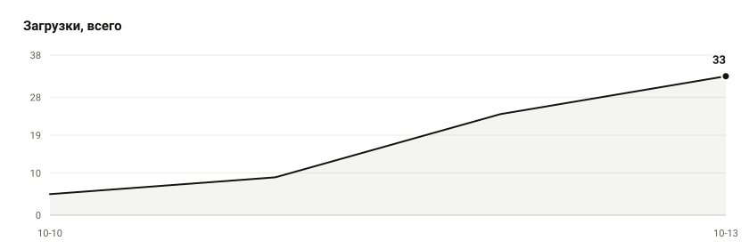

# Umbrella Scripts

Сайт Lua-скриптов для Umbrella.

Сайт: https://4ujiuh.github.io/umbrella-scripts/
Репозиторий: https://github.com/4uJIuH/umbrella-scripts

<!-- scripts:ru:start -->
- [Tinker Turret Dodge](scripts/tinker_turret_dodge) — автоматический додж опасных способностей турелями Тинкера
- [Tinker Auto Farm](scripts/tinker_auto_farm) — автоматический фарм на Тинкере
- [Auto Shackleshot](scripts/auto_shackleshot) — автоматическое применение Shackleshot за Windranger
- [Auto Spark](scripts/auto_spark) — автоматическое использование спарков на линии
<!-- scripts:ru:end -->

На странице скрипта есть описание, установка, история версий и загрузка.

## Установка

Tinker Turret Dodge: скачай `tinker_turret_dodge.lua` и `!_qLocalizer.lua` в `umbrella\scripts`,
перезагрузи Lua-скрипты и открой `General → Tinker Turret Dodge`.

Tinker Auto Farm: скачай и распакуй `Tinker-Auto-Farm.zip`, помести `Tinker.lua` и папку `lib`
в `umbrella\scripts`, перезагрузи Lua-скрипты и открой `Scripts → Scripts → Tinker`.

Auto Shackleshot: скачай `Auto_Shackleshot.lua` и `!_qLocalizer.lua` в `umbrella\scripts`,
перезагрузи Lua-скрипты и открой `Скрипты → Скрипты → Auto Shackleshot`.

Auto Spark: скачай `Auto_Spark.lua` и `!_qLocalizer.lua` в `umbrella\scripts`,
перезагрузи Lua-скрипты и открой `Скрипты → Скрипты → Auto Spark`.

---

# English

Lua scripts for Umbrella.

Site: https://4ujiuh.github.io/umbrella-scripts/
Repository: https://github.com/4uJIuH/umbrella-scripts

<!-- scripts:en:start -->
- [Tinker Turret Dodge](scripts/tinker_turret_dodge) — automatically dodges dangerous abilities with Tinker turrets
- [Tinker Auto Farm](scripts/tinker_auto_farm) — automatic farming on Tinker
- [Auto Shackleshot](scripts/auto_shackleshot) — automatic Shackleshot on Windranger
- [Auto Spark](scripts/auto_spark) — automatic Spark Wraith usage on the lane
<!-- scripts:en:end -->

The script page includes its description, installation steps, version history, and download.

## Install

Tinker Turret Dodge: download `tinker_turret_dodge.lua` and `!_qLocalizer.lua` into
`umbrella\scripts`, reload the Lua scripts, and open `General → Tinker Turret Dodge`.

Tinker Auto Farm: download and extract `Tinker-Auto-Farm.zip`, place `Tinker.lua` and the `lib`
folder in `umbrella\scripts`, reload the Lua scripts, and open `Scripts → Scripts → Tinker`.

Auto Shackleshot: download `Auto_Shackleshot.lua` and `!_qLocalizer.lua` into
`umbrella\scripts`, reload the Lua scripts, and open `Scripts → Scripts → Auto Shackleshot`.

Auto Spark: download `Auto_Spark.lua` and `!_qLocalizer.lua` into `umbrella\scripts`,
reload the Lua scripts, and open `Scripts → Scripts → Auto Spark`.

## Downloads

<!-- stats:start -->
| script | downloads | latest |
| --- | --- | --- |
| [Tinker Turret Dodge](scripts/tinker_turret_dodge) | 2 | `tinker-turret-dodge-v1.1.3` |
| [Tinker Auto Farm](scripts/tinker_auto_farm) | 2 | `tinker-auto-farm-v1.0.3` |
| [Auto Shackleshot](scripts/auto_shackleshot) | 0 | `auto-shackleshot-v1.0.0` |

<picture>
  <source media="(prefers-color-scheme: dark)" srcset=".github/stats/stats-dark.svg">
  
</picture>

2026-10-10
<!-- stats:end -->
